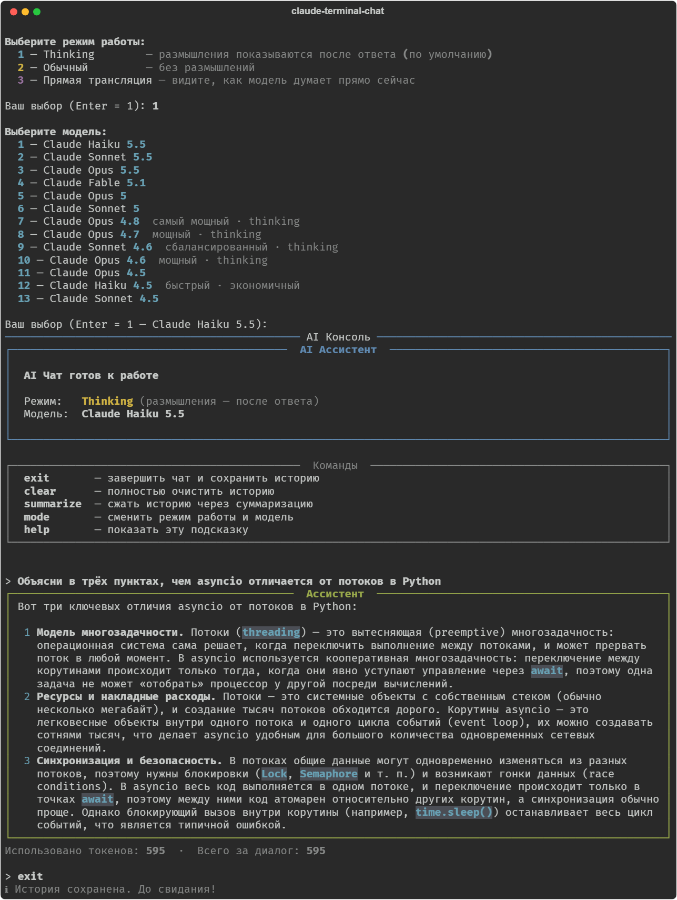

**English** · [Deutsch](README.de.md) · [Русский](README.ru.md)

# AI Console — Terminal Chat with Claude

A terminal chat assistant powered by Anthropic Claude, with a reasoning mode (Thinking), streaming output and conversation history that persists between sessions.

## What it looks like



The interface of the app is in Russian.

---

## Features

- **Three modes** — Thinking, Standard, Live stream
- **Model selection** — the list of current models is loaded from the API on every start
- **Context memory** — the whole history is sent with every request, so the model remembers the entire conversation
- **Persistent history** — the conversation is saved to `chat_history.json` and loaded on the next start
- **Rich output** — Rich panels with color coding and Markdown rendering in answers
- **Control commands** — `mode`, `clear`, `help`, `exit`

---

## Modes

| # | Mode | Description |
|---|-------|----------|
| 1 | **Thinking** | The model reasons before answering. The reasoning block is shown **after** generation is finished |
| 2 | **Standard** | Answer without internal reasoning. Faster and cheaper |
| 3 | **Live stream** | The model's reasoning is shown **in real time** as it is generated |

---

## Chat commands

| Command      | Action |
|--------------|----------|
| `exit`       | Save the history and quit |
| `clear`      | Clear the conversation history (deletes `chat_history.json`) |
| `mode`       | Open the menu to change mode and model without restarting |
| `help`       | Show the list of available commands |
| `summarize`  | Compress the history by summarizing it |

---

## Installation and running

### 1. Prerequisites

- Python 3.10+
- An API key from the [Anthropic Console](https://console.anthropic.com/)

### 2. Clone the project

```bash
git clone https://github.com/vikmi1/claude-terminal-chat.git
cd claude-terminal-chat
```

### 3. Create a virtual environment (recommended)

```bash
python -m venv .venv
```

Activate it:
- Windows: `.venv\Scripts\activate`
- macOS/Linux: `source .venv/bin/activate`

### 4. Install dependencies

```bash
pip install -r requirements.txt
```

### 5. Add your API key

Create a `.env` file in the project folder:

```
ANTHROPIC_API_KEY=sk-ant-...
```

### 6. Run

```bash
python main.py
```

---

## Project structure

```
├── main.py           # Entry point, menus, main conversation loop
├── chat.py           # API client, generate_response and stream_response
├── display.py        # Visual layout with Rich
├── history.py        # Saving and loading the history (JSON)
├── requirements.txt  # Python dependencies
├── .env              # API key (do not commit to git)
└── chat_history.json # Created automatically with the first message
```

---

## Dependencies

| Package | Purpose |
|-------|-----------|
| `anthropic` | Official Python SDK for the Claude API |
| `python-dotenv` | Loads environment variables from `.env` |
| `rich` | Nice terminal output: panels, Markdown, spinners |

---

## Models

On start, the list of models is loaded from the API — all models available on your account are shown. Models marked **thinking** support modes 1 and 3.

Anthropic models at the time of writing:

| Model | ID | Thinking |
|--------|----|:--------:|
| Claude Opus 4.8 | `claude-opus-4-8` | ✓ |
| Claude Sonnet 4.6 | `claude-sonnet-4-6` | ✓ |
| Claude Haiku 4.5 | `claude-haiku-4-5-20251001` | — |

---

## Notes

- `MAX_TOKENS = 2000` for the standard mode and `MAX_TOKENS_THINKING = 16000` for the reasoning modes — configurable in `chat.py`
- The history is stored as JSON with all content blocks, including thinking blocks, which are sent back to the API so multi-turn conversations work correctly
- When you switch the model with `mode`, the current history is kept and the conversation continues with the new model
